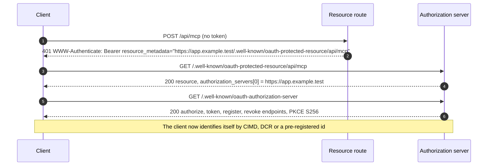
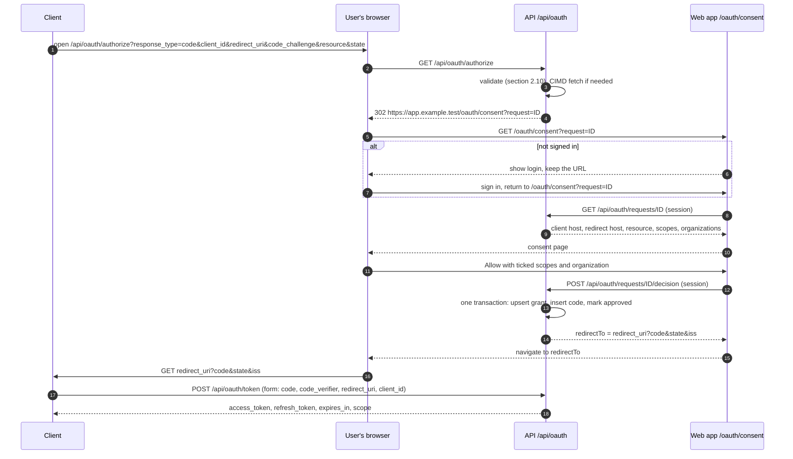
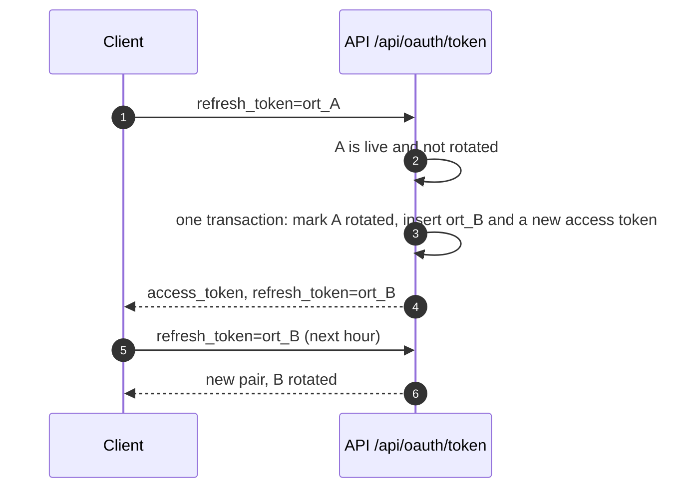
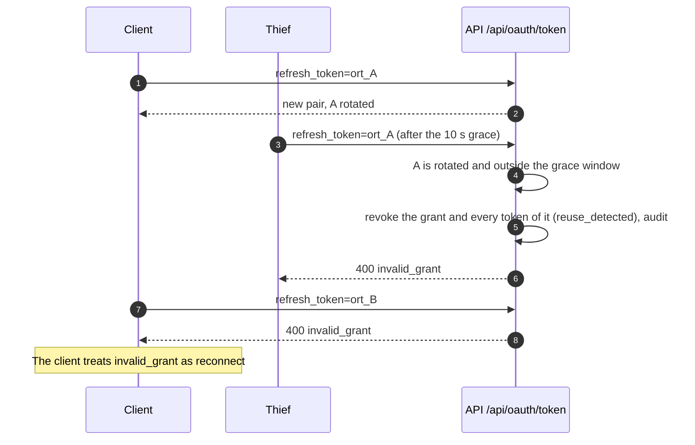
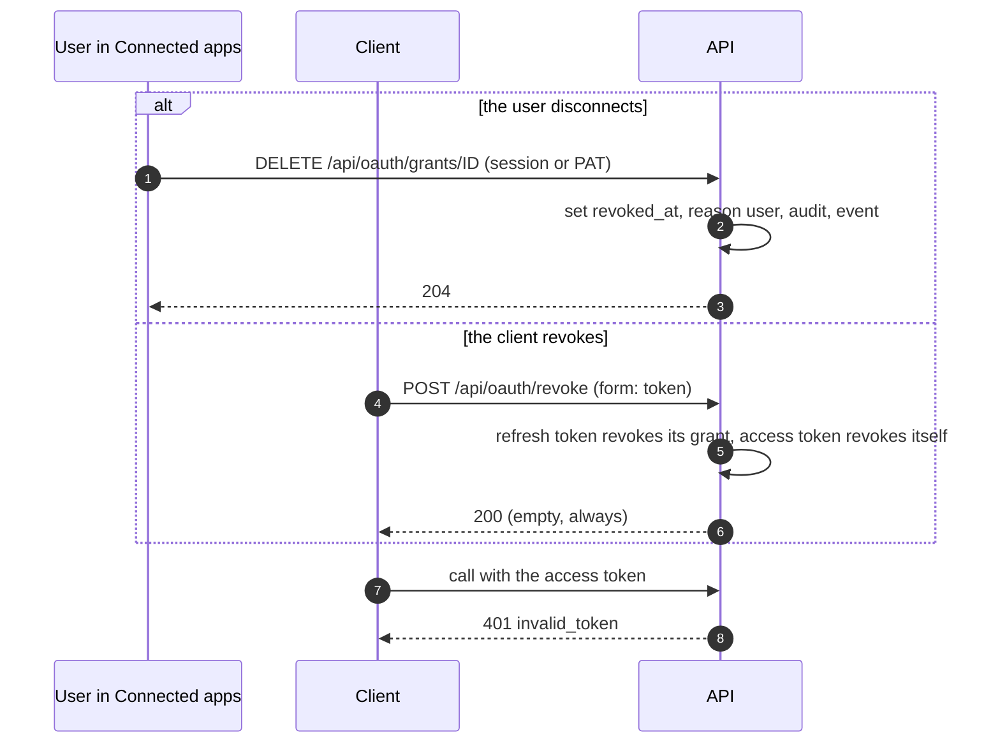
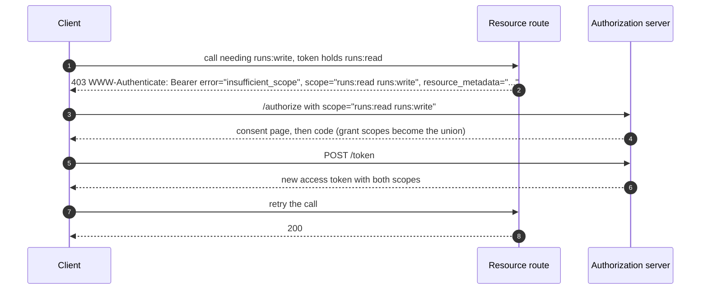

# OAuth server

> **Status:** Shipped (PP-15) · **Code:** `packages/platform-api/src/identity/oauth-server/` (API), `packages/platform-web/src/identity/ui/oauth/` (web), `packages/platform-contract/src/identity/oauth.ts` (wire shapes), `packages/platform-db/schema/oauth.prisma` (schema), `packages/platform-infra/nginx/platform/oauth-server.conf` (nginx) · **API:** `/api/oauth/*`, `/api/admin/oauth/*`, `/.well-known/oauth-*` (see `/api/docs`) · **Admin UI:** `/admin/settings/oauth-clients`; user UI `/settings/connected-apps`; consent `/oauth/consent` · **Decision:** [ADR 0003](../adr/0003-oauth-authorization-server.md) · **Runbook:** [oauth-server.md](../runbooks/oauth-server.md) · **Recipe:** [§4](#4-extending-it-in-a-fork)

The identity slice is an OAuth 2.1 authorization server and resource server. A third-party client that a user does not control (a hosted AI assistant, an MCP client, another product's integration) sends the user to a consent page in this app. The user approves what the client may do. The client receives a short-lived, scoped, audience-bound, revocable token. An app mounts the sub-slice with `IdentityModule.forRoot({ oauthServer: {} })`; it ships off until an administrator enables it at runtime.

## 1. Purpose

**What it is.** A way for a client the user does not control to act for that user without a personal access token. A fork gets discovery, client identity, consent, tokens, revocation, resource-server helpers, the pages and a conformance suite. It adds what the client may touch with two registrations: a scope and a protected resource ([§4](#4-extending-it-in-a-fork)).

**What it is not.**

- An identity provider. There are no ID tokens and no `userinfo`. The tokens work on this app's own API only.
- A replacement for personal access tokens. A PAT keeps its documented full authority on every route.
- An MCP server. The platform ships what an MCP server needs to be an OAuth resource, not the protocol.

**Out of scope** (file a follow-up only when a consumer asks):

- OpenID Connect (ID tokens, `userinfo`).
- The `client_credentials` grant (no user) and token exchange or Enterprise Managed Authorization.
- JWT access tokens and a JWKS endpoint. Tokens are opaque and looked up by hash, so revocation is immediate.
- Scopes on PATs.
- Sender-constrained tokens (DPoP, mTLS).
- Confidential clients that identify by Client ID Metadata Document (`private_key_jwt`).
- The MCP protocol itself.

### 1.1 Vocabulary

| Term | Meaning here |
|---|---|
| Authorization server | This app's OAuth endpoints. Issues codes and tokens. The issuer is the app origin (`APP_URL`, no path). |
| Resource server | The part of this app's API that accepts an `oat_` token. |
| Protected resource | One registered resource: an identifier URL (`APP_URL` + a path), the route prefixes where its tokens are admitted, and the scopes it accepts. |
| Client | The software that asks to act for a user. Identified by a `client_id`: an HTTPS metadata URL (CIMD), a generated `oc_...` id (DCR, pre-registered). |
| Grant | One user's consent to one client for one protected resource, with a set of scopes and one organization. At most one active grant per user, client and resource. |
| Scope | A named bundle of permission ids shown on the consent page. Narrows, never widens. |
| Credential kind `oauth` | The credential kind of an `oat_` access token. See [SECURITY-ARCHITECTURE.md §2](../SECURITY-ARCHITECTURE.md#2-credential-kinds). |
| CIMD | Client ID Metadata Document: the `client_id` is an HTTPS URL the server fetches to learn the client's metadata. |
| DCR | Dynamic Client Registration (RFC 7591): the client posts its metadata and receives a `client_id`. |
| Pending request | A validated `/authorize` request that waits for the user's decision. Lives 10 minutes. |
| Delegation | A signed, in-memory header (`ipd_`) that lets a resource call the app's own routes in-process with the caller's narrowed principal. |

## 2. How it works

### 2.1 Credentials

| Credential | Format | Stored as | Life |
|---|---|---|---|
| Access token | `oat_` + 32 random bytes, base64url | SHA-256 hash in `oauth_tokens` (`kind = access`) | 60 minutes (`accessTokenTtlMinutes`) |
| Refresh token | `ort_` + 32 random bytes, base64url | SHA-256 hash in `oauth_tokens` (`kind = refresh`) | 30 days, sliding, capped at 180 days from the grant's creation |
| Authorization code | `oac_` + 32 random bytes, base64url | SHA-256 hash in `oauth_authorization_codes` | 60 seconds, single use |
| Delegation | `ipd_<id>.<mac>` | In process memory only | 60 seconds, and until the originating request ends |

A token is shown once, in the token response. The database holds a hash and an 8-character display prefix. No log line, span, audit row, error body or fixture carries a token, code, secret or PKCE verifier. Logs carry the token id or the prefix only.

### 2.2 Discovery from a 401

A client learns how to sign in from the failed request itself.



### 2.3 Authorization code with PKCE, through consent

The browser, the SPA and the API take part. The consent page needs a signed-in session. When there is none, the user logs in first and returns to the same URL.



### 2.4 Refresh with rotation



### 2.5 Reuse detection

A rotated refresh token that comes back after the grace window means two parties hold it. The whole grant dies.



An authorization code used twice follows the same rule: the grant is revoked with reason `reuse_detected`.

### 2.6 Revocation



### 2.7 Step-up on 403 insufficient_scope

A call needs a scope the token lacks. The resource answers `403` with the granted and required scopes. The client sends the user through `/authorize` again with the wider set. Consent is always shown, so a prompt-injected client cannot widen its own scope silently.



### 2.8 Endpoints

All protocol endpoints use RFC wire formats. They are marked `@RawResponse()` ([core README](../../packages/platform-api/src/core/README.md)): the `{ data }` envelope is not applied, the OpenAPI document carries `x-raw-response: true` on them, and their errors are `{ "error", "error_description" }` (`OAuthProtocolExceptionFilter`), not the platform error body. The consent API, grants API and admin API are ordinary platform routes: `{ data }` envelope and standard error body.

| Endpoint | Method and path | Auth | Content type |
|---|---|---|---|
| Authorization server metadata | `GET /.well-known/oauth-authorization-server` (API: `GET /api/oauth/.well-known/authorization-server`) | public | response `application/json` |
| Protected resource metadata | `GET /.well-known/oauth-protected-resource` and `GET /.well-known/oauth-protected-resource/<resource path>` (API: `GET /api/oauth/.well-known/protected-resource[/<resource path>]`) | public | response `application/json` |
| Authorize | `GET /api/oauth/authorize` | public (redirects) | query string |
| Read a pending request | `GET /api/oauth/requests/:id` | session only | response JSON |
| Decide a pending request | `POST /api/oauth/requests/:id/decision` | session only | `application/json` |
| Token | `POST /api/oauth/token` | public; client auth per client | `application/x-www-form-urlencoded` |
| Register (DCR) | `POST /api/oauth/register` | public, rate limited | `application/json` |
| Revoke | `POST /api/oauth/revoke` | public; client auth per client | `application/x-www-form-urlencoded` |
| My connected apps | `GET /api/oauth/grants`, `DELETE /api/oauth/grants/:id` | `@Auth()`, session or PAT (an `oauth` credential is refused) | response JSON |
| Admin clients | `GET /api/admin/oauth/clients`, `POST` (pre-register), `PATCH /api/admin/oauth/clients/:id`, `POST /api/admin/oauth/clients/:id/rotate-secret`, `DELETE /api/admin/oauth/clients/:id` | `oauth_clients:read` for `GET`, `oauth_clients:write` for the rest | `application/json` |

Every public route declares `@Public()` on purpose. While the server is not enabled, every route in this table answers `404`, except `/authorize` (see below).

#### Metadata documents

Request: no parameters. Success: `200`, `Content-Type: application/json`, `Cache-Control: public, max-age=300`, `Access-Control-Allow-Origin: *`. Errors: `404` while the server is disabled; for the protected resource document, `404` for a path that matches no registered resource, and `404` on the bare path unless exactly one resource is registered. The exact documents are in [§2.9](#29-the-metadata-documents).

#### `GET /api/oauth/authorize`

Request (query): `response_type` (`code`), `client_id`, `redirect_uri`, `scope` (optional, space-separated), `state` (optional), `code_challenge`, `code_challenge_method` (`S256`), `resource`.

Success: `302` to `${APP_URL}/oauth/consent?request=<id>`. Nothing else is put in that URL.

Errors: the ordered list in [§2.10](#210-validation-at-authorize). A user-facing error is a `302` to `${APP_URL}/oauth/error?code=<code>`; `client_not_allowed` adds `&host=<host>` (URL-encoded) so an administrator knows which host to allow. A client-facing error is a `302` to `redirect_uri` with `error`, `error_description`, `state` and `iss`. This route answers while the server is disabled with the error page `server_disabled`, because a person is looking at it.

#### `GET /api/oauth/requests/:id`

Auth: session credential only. Binds the request to the caller on first read (`user_id`). Success `200`:

| Field | Meaning |
|---|---|
| `client` | `{ name, host, logoUri, kind, firstSeenAt }` |
| `redirectHost`, `isLoopbackRedirect` | Where the user goes after deciding |
| `resource` | `{ id, name }` |
| `scopes` | Requested scopes as `{ id, title, description, risk, grantable, required, alreadyGranted }`; `offline_access` is not listed here. `grantable` is false when the user lacks every permission the scope maps to. `required` marks the resource's default scopes the user cannot untick |
| `offlineAccess` | `true` when the client asked to stay connected (`offline_access` was requested); the page shows it as a line, not a tickable scope |
| `organizations` | The user's active memberships the grant may act in (`multi` tenancy), with the default |
| `expiresAt` | End of the 10-minute window |

Errors: `401` no session; `403` a PAT, device, `oauth` or `nod_` credential; `404` unknown id, a request bound to another user, or server disabled; `410` expired or already decided.

#### `POST /api/oauth/requests/:id/decision`

Auth: session credential only. Body `{ decision: 'approve' | 'deny', scopes?: string[], orgId?: string }`.

- `approve`: `scopes` must be a subset of the requested scopes and must include every `required` scope. Scopes that are not grantable are ignored. `orgId` must be an active membership; default is the session's active organization. One transaction: upsert the active grant for `(user, client, resource)` (union of scopes when one exists), insert the authorization code, mark the request `approved`. After the commit: audit `oauth:grant.create` or `oauth:grant.update`, event `identity.oauth.grant.created`.
- `deny`: mark `denied`, audit `oauth:consent.deny`.

Success `200`: `{ redirectTo }`. The URL is the client's `redirect_uri` with `code`, `state`, `iss` (approve) or `error=access_denied`, `state`, `iss` (deny). The page navigates there.

Errors: `400` invalid body or a scope outside the requested set; `401`; `403` non-session credential or an `orgId` that is not an active membership; `404` unknown, other user's or disabled; `410` expired or decided.

#### `POST /api/oauth/token`

Request (form body): see [§2.11](#211-validation-at-token). Success `200`, `Cache-Control: no-store`:

```json
{
  "access_token": "oat_...",
  "token_type": "Bearer",
  "expires_in": 3600,
  "refresh_token": "ort_...",
  "scope": "runs:read offline_access"
}
```

`refresh_token` is present when the scopes include `offline_access` or `alwaysIssueRefreshToken` is on. Errors (RFC 6749 JSON, `{ "error", "error_description" }`): `400 invalid_request` (not a form body, a missing parameter, body over 16 KiB), `401 invalid_client` (with `WWW-Authenticate: Basic`), `400 unauthorized_client` (the trust policy no longer admits the client's host, [§2.15](#215-client-identity-and-trust)), `400 invalid_grant`, `400 unsupported_grant_type`, `400 invalid_scope`, `429` ([§3](#3-configuration-and-permissions)). The form-only rule is enforced twice: a global `onRequest` hook (`installOAuthBodyGuard`) looks only at `POST /api/oauth/token` and `POST /api/oauth/revoke` and answers `400 invalid_request` before the body is read when the content type is not `application/x-www-form-urlencoded` or the declared length exceeds 16 KiB, and the handler checks the content type again. Every other route keeps the framework's body handling. Browser clients may call it cross-origin (`Access-Control-Allow-Origin: *`, no credentials, `OPTIONS` answered).

#### `POST /api/oauth/register`

Request (JSON), RFC 7591 fields: `redirect_uris` (required), `client_name`, `client_uri`, `logo_uri`, `token_endpoint_auth_method` (`none` default, `client_secret_post`, `client_secret_basic`), `grant_types`, `response_types`, `application_type` (`web` or `native`), `scope`. Unknown fields are ignored. At most 10 redirect URIs of at most 2,000 characters each; names at most 200.

Success `201`: `client_id` (`oc_...`), `client_secret` (once, confidential clients only), `client_id_issued_at`, `client_secret_expires_at: 0` and the stored metadata. A public client that registers again with exactly the same `redirect_uris`, `client_name` and host as an existing dynamic public client gets that client back, so hosted clients that register on every connection do not grow the table.

A `application_type` left out defaults to `native` when every redirect URI is loopback, else `web`. Errors (RFC 7591 JSON): `400 invalid_redirect_uri`, `400 invalid_client_metadata` (also for a body that is not `application/json`), `403 invalid_client_metadata` with `error_description` "The client host is not allowed on this deployment.", `404` while DCR is off or the server is disabled, `429` with `Retry-After`.

#### `POST /api/oauth/revoke`

Request (form): `token`, `token_type_hint` (optional), client authentication as for `/token`. Revoking a refresh token revokes its grant. Revoking an access token revokes that token. Success: always `200` with an empty body, including for an unknown token (RFC 7009). Errors: `401 invalid_client` for a confidential client that fails authentication; `429`. Unlike `/token`, `/revoke` does not apply the host trust policy: a client removed from the allowlist can still revoke.

#### `GET /api/oauth/grants` and `DELETE /api/oauth/grants/:id`

`GET` returns the caller's active grants: id, client `{ name, host, logoUri }`, resource name, scopes with titles, `createdAt`, `lastUsedAt`, organization. Never a token. `DELETE` revokes one grant (`revoked_reason: user`), audits it and emits `identity.oauth.grant.revoked`; success `204`. Errors: `401`; `403` for an `oauth` credential; `404` for an id that is not the caller's.

#### `/api/admin/oauth/clients`

| Route | Permission | Behaviour |
|---|---|---|
| `GET /` | `oauth_clients:read` | Paged list: kind, name, host, redirect URIs, active grant count, last used, disabled state |
| `POST /` | `oauth_clients:write` | Pre-register a client: name, redirect URIs, auth method. Returns the id and, once, the secret |
| `PATCH /:id` | `oauth_clients:write` | `{ disabled }`, and name and redirect URIs for the `registered` kind. Disabling takes effect on the next token resolution |
| `POST /:id/rotate-secret` | `oauth_clients:write` | New secret, returned once |
| `DELETE /:id` | `oauth_clients:write` | Delete the client; its grants, codes and tokens cascade |

Errors: `401`, `403`, `404`, `400` (invalid body). Every write is audited.

### 2.9 The metadata documents

Authorization server metadata (RFC 8414). `issuer` is `APP_URL` without a trailing slash. Fields marked "while on" appear only while their setting is on.

```json
{
  "issuer": "https://app.example.test",
  "authorization_endpoint": "https://app.example.test/api/oauth/authorize",
  "token_endpoint": "https://app.example.test/api/oauth/token",
  "registration_endpoint": "https://app.example.test/api/oauth/register",
  "revocation_endpoint": "https://app.example.test/api/oauth/revoke",
  "scopes_supported": ["runs:read", "runs:write", "offline_access"],
  "response_types_supported": ["code"],
  "grant_types_supported": ["authorization_code", "refresh_token"],
  "token_endpoint_auth_methods_supported": ["none", "client_secret_post", "client_secret_basic"],
  "code_challenge_methods_supported": ["S256"],
  "client_id_metadata_document_supported": true,
  "authorization_response_iss_parameter_supported": true
}
```

| Field | Value |
|---|---|
| `registration_endpoint` | while `dynamicClientRegistration` is on |
| `client_id_metadata_document_supported` | `true`, while `clientIdMetadataDocuments` is on |
| `scopes_supported` | every registered scope id, plus `offline_access` |
| `token_endpoint_auth_methods_supported` | always the three values; `none` is always listed |
| `code_challenge_methods_supported` | always `["S256"]`; `plain` is never listed |

The document has no other field. In particular it has no `jwks_uri` and no OpenID fields. `/.well-known/openid-configuration` answers a JSON `404`.

Protected resource metadata (RFC 9728), one document per registered resource:

```json
{
  "resource": "https://app.example.test/api/mcp",
  "authorization_servers": ["https://app.example.test"],
  "scopes_supported": ["runs:read", "runs:write", "offline_access"],
  "bearer_methods_supported": ["header"],
  "resource_name": "Agent tools (MCP)",
  "resource_documentation": "https://app.example.test/docs/agent-tools"
}
```

| Field | Rule |
|---|---|
| `resource` | `APP_URL` + the resource's `path`, with no trailing slash. It equals the URL a user types into the client |
| `authorization_servers` | Exactly one entry, the issuer. Clients use only the first |
| `scopes_supported` | The resource's scopes plus `offline_access` |
| `resource_documentation` | Present only when the resource registers one |

### 2.10 Validation at authorize

Checks run in this order. The first failure ends the request.

| # | Check | Failure | Shown to |
|---|---|---|---|
| 1 | The server is mounted and enabled | Error page `server_disabled` | The user |
| 2 | `client_id` resolves to a client that is not disabled, and the trust policy admits its host ([§2.15](#215-client-identity-and-trust)); a CIMD client is fetched here | Error page: `unknown_client`, `client_not_allowed`, `client_metadata_unavailable` | The user, never a redirect |
| 3 | `redirect_uri` is present and matches one of the client's URIs ([§2.12](#212-redirect-uri-matching)) | Error page `invalid_redirect_uri` | The user, never a redirect |
| 4 | `response_type` is `code` | Redirect `unsupported_response_type` | The client |
| 5 | `code_challenge` is present and `code_challenge_method` is `S256` (`plain` and absent are refused) | Redirect `invalid_request` | The client |
| 6 | `resource` is present and equals a registered protected resource identifier (compared after lower-casing scheme and host, dropping a fragment and a trailing slash) | Redirect `invalid_target` | The client |
| 7 | Each requested scope is registered and accepted by that resource (`offline_access` is accepted by every resource); with no scope requested, the resource's `default: true` scopes apply | Redirect `invalid_scope` | The client |

From check 4 on, a redirect carries `error`, `error_description`, `state` (when sent) and `iss`. A bad client or a bad redirect URI is never sent to the redirect URI, because that is how an open redirect starts. On success the server inserts an `oauth_authorization_requests` row (10 minutes) and redirects to the consent page.

### 2.11 Validation at token

Body limit 16 KiB. A JSON body is `400 invalid_request`. The client is authenticated first: `none` (public, `client_id` in the body), `client_secret_post` or `client_secret_basic`, as the client's `token_endpoint_auth_method` says. A confidential client that fails is `401 invalid_client`. Then the host trust policy runs on the stored client (no fetch): a client the policy no longer admits is `400 unauthorized_client`.

`grant_type=authorization_code` (`code`, `redirect_uri`, `code_verifier`, `client_id`, `resource` optional):

| # | Check | Failure |
|---|---|---|
| 1 | The code exists (by hash) | `invalid_grant` |
| 2 | The code is not consumed | The grant is revoked (`reuse_detected`), `invalid_grant` |
| 3 | The code is not expired, belongs to this client, `redirect_uri` is identical to the stored one, and `resource`, when sent, equals the stored one | `invalid_grant` |
| 4 | `BASE64URL(SHA256(code_verifier))` equals the stored `code_challenge` (constant-time compare) | `invalid_grant` |
| 5 | One transaction: consume the code, insert the access token and, when allowed, the refresh token | none |

`grant_type=refresh_token` (`refresh_token`, `client_id`, `scope` optional):

| # | Check | Failure |
|---|---|---|
| 1 | The token exists, is not expired, belongs to this client, its grant is not revoked, its client is not disabled | `invalid_grant` (exactly this code: clients treat it as "reconnect") |
| 2 | The token is not rotated; if it is, outside the 10-second grace window | The grant and every token of it are revoked (`reuse_detected`), audit `oauth:token.reuse_detected`, `invalid_grant` |
| 3 | `scope`, when sent, is a subset of the token's scopes | `invalid_scope` |
| 4 | One transaction: rotate, insert the new refresh token and access token. A narrower `scope` narrows only the new access token; the new refresh token keeps the grant's full scope, so a client may narrow one access token and widen the next | none |

A missing `grant_type` is `invalid_request`; any other value is `unsupported_grant_type`. The token endpoint makes no outbound call and runs five data statements on each hot path (the client row, the code or refresh token, its grant, then in one transaction the conditional update that consumes or rotates and one insert of both tokens; `BEGIN` and `COMMIT` are not counted), because hosted clients abandon token calls after 10 seconds. `oauth-authorization-server.db.spec.ts` pins the count.

### 2.12 Redirect URI matching

- The comparison is exact string match against the client's registered URIs.
- Loopback is the one exception (RFC 8252 section 7.3). For `http://127.0.0.1`, `http://[::1]` and `http://localhost`, the port is ignored. Scheme, host (the same loopback name), path and query still match exactly.
- `https` redirect URIs of a hosted client never match on a prefix, a wildcard or a case change of the path.
- The token endpoint compares the stored `redirect_uri` of the code to the sent one byte for byte, including the port the client actually used.

### 2.13 Token lifetimes, rotation and reuse

| Object | Created | Life | Becomes invalid when | On reuse |
|---|---|---|---|---|
| Authorization code | Approve | 60 s | Consumed, expired, grant revoked | The grant is revoked, `reuse_detected` |
| Pending request | `/authorize` | 10 min | Decided, expired | `410` |
| Access token | Code exchange, refresh | 60 min (5 to 1440) | Expired, revoked, grant revoked, client disabled, user inactive, membership lost | not applicable |
| Refresh token | Code exchange (when allowed), refresh | 30 days from creation or last rotation (1 to 365), capped at 180 days from the grant's creation (`refreshTokenMaxAgeDays`, 0 for no cap) | Rotated, expired, grant revoked | Outside the grace window: the grant and all its tokens are revoked |
| Rotated refresh token | Marked on rotation | Kept until cleanup | Immediately, except inside the grace window | See above |
| Grant | First approval | Until revoked | `revoked_at` set, reason one of `user`, `admin`, `reuse_detected`, `client_disabled`, `offboarding` | not applicable |

**Grace window.** For 10 seconds after a rotation, presenting the previous refresh token again is not reuse. The server does not hold the raw successor (only its hash), so it cannot return the same successor. It revokes the first successor, issues a new refresh token and a new access token, and points the old token's `replaced_by_id` at the new refresh token. A client that lost the response keeps its grant. If the first successor was already used before the retry, the retry is reuse.

**Refresh response.** A refresh always returns a new refresh token and a new access token. The new refresh token's window starts at the rotation.

### 2.14 The guard's algorithm for `Bearer oat_`

`JwtAuthGuard` gets a branch beside `pat_` and `nod_`, after `@Public()`. Order matters: the cheap, local checks come first, so a refused request causes no database load and gives no hint whether a token exists.

1. **Feature gate.** The sub-slice is mounted and `oauthServer.enabled` is true (cached 5 seconds). Otherwise `401`.
2. **Route confinement, no I/O.** The request path (query string stripped) equals a route prefix of some registered protected resource or lies under it (`prefix + '/'`). Otherwise `403`: "OAuth access tokens may only be used on the resource they were issued for". The same prefix helper as the `nod_` rule is reused.
3. **Lookup.** Hash the token and find the `access` row. Not found: `401`.
4. **Expiry and revocation.** Refuse when the token is revoked or expired, its grant is revoked, its client is disabled, or the user is inactive.
5. **Grant and membership.** The grant's `resource` equals the resource whose prefix matched in step 2, else `403`. The grant's organization is an active membership of the user (in `single` tenancy mode, as a PAT behaves).
6. **Permission narrowing.** Effective permissions = the user's permissions (system and org, as the principal factory computes them) ∩ the union of the permissions of the token's scopes. The set is built on a copy and never written to the principal cache.
7. **Principal stamping.** `request.user` is the user. `request.authCredential` is `{ kind: 'oauth', tokenId, grantId, clientId, resourceId, scopes }`. The principal carries non-enumerable `oauth` metadata (also read through `@OAuthGrant()`). `last_used_at` of the token and the grant is written at most once a minute per token, without waiting.

Every refusal in steps 3 to 5 that concerns the token answers the same `401` message. A route under a protected resource that gets `401` also carries the `WWW-Authenticate` challenge ([§2.16](#216-challenges)).

`RolesGuard` never admits an `oauth` credential on role alone: a route guarded only by `@Roles()` is refused unless a registered scope names a permission that route also declares. `switchOrg`, PAT creation, the consent routes and every other session-only route refuse an `oauth` credential.

### 2.15 Client identity and trust

A deployment decides which clients may exist at all. The default is closed.

**Host of a client.** The host of the `client_id` URL (CIMD). For DCR and pre-registered clients: the one host shared by all non-loopback redirect URIs (mixed hosts are refused at registration), or `loopback` when every redirect URI is loopback.

**Admission rule.** Admit when the client is `registered` (an administrator made it), or `allowAnyClientHost` is on, or the host is in `allowedClientHosts`, or the host is `loopback` and `allowLoopbackClients` is on. A CIMD client also needs every non-loopback redirect URI on the `client_id` host or on a host in `allowedClientHosts`. The policy (`evaluateClientTrust`, `ClientTrustPolicy`) runs at `/authorize`, at registration and at `/token` (stored data only, no fetch), so a host removed from the allowlist stops refreshing; `/revoke` is not gated. A refusal at `/authorize` shows the error page `client_not_allowed&host=<host>` and writes `oauth:client.refused` to the audit log, at most one row per host per hour. The admin page lists refused hosts from those rows and offers "Allow this host".

**CIMD.** A `client_id` is a CIMD URL when it is an `https:` URL with a path, no fragment, no userinfo and no dot segments. Anything else is an opaque id. The fetch happens at `/authorize` only, through the egress guard and the pinned GET transport in `packages/platform-api/src/core/egress/` (the guard webhooks use too, [webhooks §2.7](webhooks.md#27-the-ssrf-guard)): HTTPS only, public addresses only, no redirects, 5-second timeout and 8-second overall deadline, 64 KiB cap, `Accept: application/json`. The document must be JSON, `client_id` must equal the URL exactly, `client_name` and a non-empty `redirect_uris` array must be present, and `token_endpoint_auth_method` must be absent or `none` (a document asking for a secret is refused with the internal reason `confidential_not_supported`). The row is cached by HTTP cache headers, clamped to between 5 minutes and 24 hours. A failed refetch uses the cached copy; with no copy the error page is `client_metadata_unavailable`. Fetched text is never rendered as HTML. `logo_uri` is shown only when it is `https:` and on the client's host.

**DCR.** Off with `dynamicClientRegistration`. Redirect URIs are `https:` or loopback `http:`, with no fragment. A custom scheme is allowed only for `application_type: native` and a reverse-domain scheme. The trust policy runs at registration too.

**Pre-registered.** An administrator creates the client in the admin UI and passes the id and secret to the other side. A registered client skips the host allowlist.

### 2.16 Challenges

`buildBearerChallenge({ resourceId, error?, errorDescription?, scope? })` returns `Bearer resource_metadata="<absolute url>", error="...", error_description="...", scope="a b"`, quoted correctly and without line breaks.

- **401.** A request to a route under a protected resource's prefix with no credential, an invalid or expired `oat_` token, or a failed PAT or session gets `401` with the challenge. `error="invalid_token"` appears only when a token was presented. Routes outside any resource keep their existing `401` exactly.
- **403 insufficient_scope.** `throw new InsufficientScopeException({ resourceId, requiredScopes })`, or `assertOAuthScopes(principal, resourceId, scopes)`. The answer is `403` with `WWW-Authenticate: Bearer error="insufficient_scope", scope="<granted ∪ required>", resource_metadata="..."`. Granted and required scopes are both listed, because clients do not reliably carry earlier scopes into a step-up. For a caller that is not an `oauth` credential it is an ordinary `403`.
- **Guard denial.** A permission denial for an `oauth` principal on a resource route becomes `insufficient_scope` when a registered scope of that resource grants the missing permission and the user holds it (re-consent can fix it). Otherwise it is a plain `403`.
- **A resource decides inside the HTTP status.** The refusal must be a real `401` or `403`, never a `200` carrying an error result. Hosted clients start sign-in only from an HTTP status.

### 2.17 Scope and protected-resource registries

Both fill at import time on the `defineRegistry` primitive and freeze at bootstrap. Scope ids follow the open-vocabulary rule in [EXTENDING.md](../EXTENDING.md#open-an-id-vocabulary).

```ts
registerOAuthScope({
  id: 'runs:read',            // /^[a-z][a-z0-9_]*(:[a-z][a-z0-9_]*)?$/, at most 64 characters
  title: 'Read your runs',    // shown on the consent page
  description: 'See the runs you can see in the app.',
  permissions: ['runs:read'], // permission ids; each must be registered (boot error otherwise)
  risk: 'low',                // 'low' | 'elevated' | 'high'
  default: true,              // requested when the client asks for no scope
});

registerOAuthProtectedResource({
  id: 'mcp',
  path: '/api/mcp',                      // resource identifier = APP_URL + path
  routePrefixes: ['/api/mcp'],           // where an oat_ token for this resource is admitted
  scopes: ['runs:read', 'runs:write'],   // subset of the registered scopes
  name: 'Agent tools (MCP)',
  documentation: 'https://app.example.test/docs/agent-tools', // optional
});
```

Rules:

- `offline_access` is built in. It has no permissions and allows a refresh token.
- A scope that names an unregistered permission is a boot error that names the scope.
- Two resources may not share or nest route prefixes (boot error).
- `/api/oauth`, `/api/auth` and `/api/nodes` can never be a route prefix (boot error).
- Each resource lists at least one `default: true` scope.

### 2.18 In-process delegation

A resource such as an MCP endpoint calls the app's own REST routes with `fastify.inject`. Those routes are outside its prefix, so an `oat_` header would be refused at step 2 of the guard, and forwarding it would defeat audience binding. The platform provides a delegation instead.

- `InProcessDelegation.headerFor(request)` returns `Authorization: Bearer ipd_<id>.<mac>` for the current request's principal, whatever its credential kind.
- The id maps to an in-memory entry: the user graph reference, the credential info, the narrowed permissions and `expiresAt = now + 60 s`. The MAC is HMAC-SHA-256 under a key generated at process start. The key is never stored or logged.
- The entry is dropped at expiry and when the originating request ends (`onResponse`).
- The guard accepts `Bearer ipd_...` only when the request did not arrive over a socket. `InProcessDelegation.inject(request, opts)` is the only API that produces a valid call. A network request that carries an `ipd_` header gets `401` and a warning log.
- The delegated request has the same principal, credential kind (`oauth`) and narrowed permissions. Route confinement is skipped for it. That is its purpose.
- The invariant: **a delegation is unusable from the network and unusable after its originating request ends.** It works for session and PAT principals too, so a resource has one code path.

### 2.19 Consent

The consent page is `/oauth/consent?request=<id>` in the signed-in web app, outside the shell like `/activate`. The only request detail taken from the URL is the opaque id.

- It leads with the **host** of the client in bold, and shows the self-asserted name and logo as secondary.
- It names the host the user returns to, and warns on a loopback redirect.
- It says when the client is new on this deployment (first seen under 24 hours ago, or no other grant).
- Scopes are grouped by `risk`. `low` scopes are listed; the resource's required scopes cannot be unticked. `elevated` scopes are unticked unless the client asked for them and an active grant already holds them. `high` scopes are always unticked and carry a warning. A scope the user cannot use is disabled with an explanation.
- `offline_access` is not a tickable scope. It appears as a line, "Stay connected without asking again", and is granted with the grant when requested.
- In `multi` tenancy the user picks the organization the grant acts in.
- `Allow` is disabled for one second after render and while submitting. A signed-out user logs in and returns to the same URL.
- Consent is never skipped for a returning public client. The page may pre-tick and say "already connected".
- Only a session credential may approve. A PAT, device token or `oat_` token cannot.
- The page is not framable (`frame-ancestors 'none'`).

### 2.20 Data model

Five tables, created by one platform migration. They are user-owned, not `org` tables: no row-level security, resolved before any org scope exists, as for `personal_access_tokens`.

| Table | Holds | Notable columns |
|---|---|---|
| `oauth_clients` | One client | `client_id` (unique), `kind` (`cimd`, `dynamic`, `registered`), `name`, `client_uri`, `logo_uri`, `redirect_uris` (jsonb), `token_endpoint_auth_method`, `secret_hash`, `application_type`, `host`, `metadata_fetched_at`, `metadata_expires_at`, `created_by_user_id` (set null on delete), `disabled_at`, `last_used_at`, `created_at` |
| `oauth_authorization_requests` | A request waiting for consent | `id` (the opaque id), `client_id`, `redirect_uri`, `scope`, `state`, `resource`, `code_challenge`, `code_challenge_method` (`S256`), `user_id` (set at first read), `status` (`pending`, `approved`, `denied`, `expired`), `expires_at`, `created_at` |
| `oauth_grants` | One consent | `user_id`, `org_id` (nullable, same expand-step posture as `PersonalAccessToken.orgId`), `client_id`, `resource`, `scopes` (text[]), `created_at`, `updated_at`, `last_used_at`, `revoked_at`, `revoked_reason` |
| `oauth_authorization_codes` | A code | `code_hash` (unique), `grant_id`, `redirect_uri`, `code_challenge`, `scope`, `resource`, `expires_at`, `consumed_at`, `created_at` |
| `oauth_tokens` | An access or refresh token | `kind` (`access`, `refresh`), `token_hash` (unique), `token_prefix`, `grant_id`, `scopes`, `expires_at`, `created_at`, `last_used_at`, `rotated_at`, `replaced_by_id`, `revoked_at` |

`oauth_grants_active_uniq_idx` is a raw-SQL partial unique index on `(user_id, client_id, resource) WHERE revoked_at IS NULL`. It exists only in migration SQL and is listed in `packages/platform-db/raw-sql-indexes.json`. Never model it with `@@unique`. Deleting a user cascades grants, codes and tokens. Deleting a client cascades its grants.

**What each operation does with the data.**

| Operation | `oauth_grants` (and tokens, codes) | `oauth_authorization_requests` | `oauth_clients` |
|---|---|---|---|
| User-data purge | Deleted | Deleted | Kept; `created_by_user_id` set to null |
| Export (`user-data`) | Exported as presentation-safe rows: client name and host, resource, scopes, dates. Never a hash, token or prefix | Not exported | Not exported |
| Organization offboarding | The org's grants are revoked (`revoked_reason: offboarding`) | Untouched (expire on their own) | Kept |
| Database backup and restore | Carried with the database; no special handling | Same | Same |

### 2.21 Audit, events, metrics and logs

Names only. Every audit row carries the actor and target id, never a secret.

| Kind | Names |
|---|---|
| Audit actions | `oauth:grant.create`, `oauth:grant.update`, `oauth:grant.revoke`, `oauth:consent.deny`, `oauth:token.reuse_detected`, `oauth:client.create`, `oauth:client.update`, `oauth:client.disable`, `oauth:client.enable`, `oauth:client.delete`, `oauth:client.rotate_secret`, `oauth:client.refused`, `oauth:settings.update` (target `oauth_settings`, id `oauthServer`; the meta lists the changed field names, each field's `<field>From` and `<field>To` for scalars, and `allowedClientHostsAdded` / `allowedClientHostsRemoved` for the host list) |
| Events (after commit) | `identity.oauth.grant.created`, `identity.oauth.grant.revoked`, each `{ userId, grantId, clientId, resourceId, reason }`. The platform sends no notification itself; an app listens and notifies ([README recipe](../../packages/platform-api/src/identity/README.md#oauth-server)) |
| Metrics | `OAUTH_APP_METRICS` (an app registers it with `registerPlatformHostAppMetrics`): `app.oauth.authorizations` (`outcome`: approved, denied, error), `app.oauth.tokens.issued` (`grant_type`), `app.oauth.token.refusals` (`reason`: an OAuth error code), `app.oauth.client.registrations` (`kind`: dynamic, cimd, registered). Labels are low-cardinality: never a client id, host or user. Without the registration or an `IDENTITY_METRICS` binding nothing is recorded and nothing fails |
| Spans | `oauth.authorize`, `oauth.decision` and `oauth.token`, with `oauth.client.kind`, `oauth.resource.id` and, on `oauth.token`, `oauth.grant_type`. Never a token |
| Log fields | Token id or 8-character prefix, grant id, client id, resource id, outcome. Never a token, code, secret, verifier or fetched document body |

### 2.22 Housekeeping jobs

Both are server-only queue jobs enqueued by a `@Cron` through `enqueueHousekeepingJob` with `orgId: null` ([job queue spec](job-queue.md#all-long-running-work-is-a-job)). A job type string is permanent once jobs of that type exist.

| Job type | Cron | Deletes |
|---|---|---|
| `oauth.token.cleanup` | Hourly, `7 * * * *` | Expired or decided authorization requests; authorization codes consumed or expired more than 1 hour ago; access tokens expired more than 24 hours ago; refresh tokens expired or rotated more than 7 days ago; the tokens of grants revoked more than 30 days ago; revoked grants after 90 days. Batches of 500 rows, at most 200 batches per table per run |
| `oauth.client.cleanup` | Daily, `17 4 * * *` | `dynamic` clients with no grant and no use for `dynamicClientUnusedDays` |

The retention numbers are `OAUTH_TOKEN_RETENTION` (exported). The Doctor check `oauth.token_cleanup` warns when a token that expired more than 7 days ago is still stored.

### 2.23 Threat model

| Threat | Mitigation |
|---|---|
| Authorization code interception | PKCE S256 required on every request; `plain` is refused; code lives 60 seconds and is single use; a second use revokes the grant |
| Open redirect | A bad client or redirect URI is an error page, never a redirect. Exact redirect matching |
| Client impersonation | The consent page leads with the host, not the self-asserted name. The host allowlist is closed by default. CIMD redirect URIs must sit on the client's host or an allowed host |
| CIMD SSRF | Every fetch goes through the egress guard: HTTPS, public addresses, pinned connection, no redirects, size cap, timeout. The fetch is at `/authorize` only |
| Consent CSRF | Session credential only. The request id is bound to the first user who reads it; another user gets `404` |
| Click-jacking of consent | `frame-ancestors 'none'`; `Allow` disabled for the first second |
| Refresh token theft | Rotation on every use; reuse revokes the whole grant; 10-second grace only for a lost response |
| Token leakage in logs | Opaque tokens, hashes at rest, prefix-only logging, captured-log assertions in the conformance suite |
| Confused deputy | Route confinement keyed on the resource the grant names; no token pass-through; in-process delegation instead of forwarding the token |
| Mix-up attack | `iss` on every authorization response, equal to the metadata `issuer` |
| Scope escalation | Effective permissions = user ∩ scopes. A scope the user lacks grants nothing. `@Roles()` alone never admits an `oauth` credential |
| Prompt-injected client asks for more scope | Step-up needs a fresh consent page. Consent is never skipped |
| Disabled or removed user | Every resolution re-checks the user, the grant's membership and the client |
| DCR flooding | 10 registrations per source address per hour; identical public registrations return the existing client; unused dynamic clients expire |
| Brute force of tokens or secrets | 256-bit random tokens; secrets stored hashed; per-client and per-address rate limits |
| Delegation replay from the network | `ipd_` accepted only on in-process requests, 60 seconds, ends with the originating request |
| Hosted client cannot reach the server | Doctor checks the public URL and the two well-known documents |

### 2.24 Hosted client compatibility

Facts the implementation satisfies. Re-verify against the source pages when implementing; vendors change them. These rows are integration facts, not fixtures: tests use placeholder hosts.

| Client | Redirect URI | Identity | Notes | Last verified | Source |
|---|---|---|---|---|---|
| Claude (web, desktop, mobile, Cowork) | `https://claude.ai/api/mcp/auth_callback` | CIMD when the metadata advertises it and `none` auth; else DCR | Uses only the first `authorization_servers` entry. 10 s limit on discovery, registration and token calls, 30 s on refresh. Caches discovery about 5 minutes. Refreshes on `401` and up to 5 minutes before expiry. Expects `invalid_grant` for a dead refresh token. Appends `offline_access` when listed in `scopes_supported` | 2026-11-17 | [Claude connector authentication](https://claude.com/docs/connectors/building/authentication), [lazy authentication](https://claude.com/docs/connectors/building/lazy-authentication) |
| Claude Code | Loopback, any port: `http://localhost:<port>/callback`, `http://127.0.0.1:<port>/callback` | CIMD `https://claude.ai/oauth/claude-code-client-metadata` | Loopback redirect URIs match with the port ignored, for `localhost` as well as `127.0.0.1` | 2026-11-17 | [Claude connector authentication](https://claude.com/docs/connectors/building/authentication) |
| ChatGPT | `https://chatgpt.com/connector_platform_oauth_redirect` (reported to be used when the server supports RFC 9207 `iss`); otherwise a per-connection `https://chatgpt.com/connector/oauth/<id>` | CIMD preferred, DCR supported, or a predefined client | Rejects an authorization response whose `iss` is wrong | 2026-11-17 | [ChatGPT authentication](https://developers.openai.com/plugins/build/auth), [MCP](https://developers.openai.com/api/docs/mcp) |

Common to all: a real HTTP `401` with `WWW-Authenticate` starts sign-in (a `200` with an error body does not); RFC 9728 `resource` equals the URL the user typed; `application/x-www-form-urlencoded` on the token endpoint; PKCE S256; the RFC 8707 `resource` parameter. To trust these vendors, an administrator adds their hosts to `allowedClientHosts` (for example `claude.ai` and `chatgpt.com`); the platform ships no default list. The protocol reference is the MCP authorization specification, revisions [2025-11-25](https://modelcontextprotocol.io/specification/2025-11-25/basic/authorization) and 2026-07-28 (clients validate `iss`; DCR is deprecated in favour of CIMD; DCR clients send `application_type`).

## 3. Configuration and permissions

**Options** (`IdentityModule.forRoot({ oauthServer })`, code options):

| Option | Default | Meaning |
|---|---|---|
| `oauthServer` | absent (not mounted) | Mounts the sub-slice. Unmounted: an `oat_` header is `401` and no route exists |
| `oauthServer.defaultAllowedClientHosts` | none | Hosts the admin UI offers as suggestions. The platform ships none |
| Protected resources and scopes | none | Registered with `registerOAuthProtectedResource` and `registerOAuthScope` at import time, not through options |
| `OAUTH_RATE_LIMITER` | in-memory fixed window | Injection token. An app with several replicas replaces it with a shared store |
| `OAUTH_CLIENT_RESOLVER` | the stored-client resolver with CIMD and the trust policy | Injection token. Says where a `client_id` comes from |
| `OAUTH_CIMD_TRANSPORT`, `OAUTH_CIMD_HOST_RESOLVER` | the pinned GET transport and the system resolver | Injection tokens for the metadata-document fetch. Tests script them so nothing touches the network |

There is no environment variable. The server is runtime-configured.

**Settings** (namespace `oauthServer`, system scope, edited at `/admin/settings/oauth-clients`):

| Field | Type | Default | Meaning |
|---|---|---|---|
| `enabled` | boolean | `false` | The switch. Off: all routes `404` (authorize shows an error page), `oat_` is `401` |
| `accessTokenTtlMinutes` | integer, 5 to 1440 | 60 | Access token life |
| `refreshTokenTtlDays` | integer, 1 to 365 | 30 | Refresh token window, restarted on each rotation |
| `refreshTokenMaxAgeDays` | integer, 0 or more (0 = no cap) | 180 | Cap on a grant's refresh chain, from the grant's creation |
| `alwaysIssueRefreshToken` | boolean | `true` | Issue a refresh token even when `offline_access` was not requested (several hosted clients never ask) |
| `clientIdMetadataDocuments` | boolean | `true` | CIMD on; advertises `client_id_metadata_document_supported` |
| `dynamicClientRegistration` | boolean | `true` | DCR on; advertises `registration_endpoint` |
| `allowedClientHosts` | string[] | `[]` | Exact lower-case hosts (no scheme, no wildcard) whose clients may connect |
| `allowAnyClientHost` | boolean | `false` | Development and open deployments only; the admin UI warns |
| `allowLoopbackClients` | boolean | `true` | Native clients whose redirect URIs are all loopback |
| `dynamicClientUnusedDays` | integer, 1 to 90 | 7 | A DCR client never used to complete an authorization is deleted after this |

The settings slice registers the `oauthServer` namespace only while the sub-slice is mounted (`isOAuthServerMounted()`); the namespace is declared by identity's zod schema and read through the `IDENTITY_OAUTH_SETTINGS` port, so an unbound port reads as off. Changes are audited as `oauth:settings.update`.

Fixed in code, not settings: authorization code life (60 s), pending request life (10 min), refresh grace window (10 s), CIMD fetch limits (5 s, 64 KiB, cache 5 minutes to 24 hours).

**Permissions.** A route enforces exactly one string.

| Permission | Scope | Default grants | Gates |
|---|---|---|---|
| `oauth_clients:read` | system | `admin` | `GET /api/admin/oauth/clients` and the admin card |
| `oauth_clients:write` | system | `admin` | `POST`, `PATCH`, `DELETE` and rotate on `/api/admin/oauth/clients`; the settings controls inside the page |

The consent API and grants API need no permission: any signed-in user manages their own grants. The full matrix goes into [ARCHITECTURE.md §7.2](../ARCHITECTURE.md#72-permission-matrix) when the permissions are built.

**Rate limits** (in-memory fixed window, `429` with `Retry-After` and body `{ "error": "temporarily_unavailable", "error_description": "Too many requests." }`):

| Endpoint | Limit |
|---|---|
| `/api/oauth/authorize` | 30 per minute per source address |
| `/api/oauth/token` | 60 per minute per client id |
| `/api/oauth/revoke` | 60 per minute per client id |
| `/api/oauth/register` | 10 per hour per source address |

**Edge and headers.** nginx proxies `/.well-known/oauth-authorization-server` (and a path-suffixed form), `/.well-known/oauth-protected-resource` and `/.well-known/oauth-protected-resource/<path>` to the API, and answers `/.well-known/openid-configuration` with a JSON `404`, from `packages/platform-infra/nginx/platform/oauth-server.conf` (as `/.well-known/assetlinks.json` is served today); an app opts in with `include /etc/nginx/platform/oauth-server.conf;` in `infra/nginx/app.d/locations/oauth-server.conf`. In development the Vite dev server maps the same paths (`apps/web/build-config/oauth-well-known.ts`). They always answer JSON, never the SPA. The two metadata documents, `/token`, `/register` and `/revoke` send `Access-Control-Allow-Origin: *` with no credentials, and `/token`, `/register` and `/revoke` answer `OPTIONS` with `Access-Control-Allow-Headers: content-type, authorization`. The wildcard is safe because these endpoints take no cookie and no credential is ever sent with the request. The controllers set the headers and answer `OPTIONS`. That is enough while `CORS_ORIGIN` is unset (the default). When `CORS_ORIGIN` lists an allowlist, the CORS plugin answers every preflight in an `onRequest` hook before any route handler runs, so the allowlist would answer these endpoints too. The app therefore passes `buildCorsOptions(process.env.CORS_ORIGIN, { openPaths: OAUTH_PUBLIC_CORS_PATHS })` (`apps/api/src/main.ts`): the plugin's per-request options delegate answers `*` without credentials for exactly the token, register and revoke endpoints and `/api/oauth/.well-known/`, and every other route, `/api/oauth/authorize` and the consent routes included, keeps the allowlist. `buildCorsOptions` itself is not loosened for the rest of the API.

**Source address behind a proxy.** The per-address rate limits (`/authorize`, `/register`) key on `request.ip`. Neither the reference app nor the platform host sets Fastify's `trustProxy`, so behind nginx every caller shares the proxy's address and one bucket. A deployment that needs per-caller limits sets `trustProxy` on its `FastifyAdapter` (to the proxy's address, never `true` on an exposed listener) or replaces `OAUTH_RATE_LIMITER`.

**Doctor checks** (category `auth`, read-only, registered only while the sub-slice is mounted; [doctor spec](doctor.md)). While the server is off, all of them except `oauth.token_cleanup` report `skip`.

| Id | Verdicts | Settings path |
|---|---|---|
| `oauth.public_url` | `warn` when `APP_URL` is unset, not `https:` or a loopback or private host (hosted clients cannot reach it); else `pass` | `/admin/settings/oauth-clients` |
| `oauth.well_known` | Requests the authorization server document and each registered resource's document (at most 5) through the public URL, with the egress guard. `fail` when one does not answer JSON with the expected `issuer` or `resource` (a proxy, CDN or the SPA is answering); `warn` when one cannot be requested; `skip` on a private or non-https address; else `pass`. Depends on `oauth.public_url`; 12 s budget | `/admin/settings/oauth-clients` |
| `oauth.client_policy` | `warn` when `allowAnyClientHost` is on; else `pass`, listing the allowed hosts | `/admin/settings/oauth-clients` |
| `oauth.resources` | `warn` when enabled with no protected resource; else `pass`, listing resources and scope counts | `/admin/settings/oauth-clients` |
| `oauth.token_cleanup` | `warn` when a token that expired more than 7 days ago is still stored (the cleanup job is not running); else `pass`. Depends on `db.connection` | `/admin/settings/jobs` |

**Settings cards** (declared as data, appended to the app registries): `Connected apps` in the user hub (`/settings/connected-apps`, `feature: 'oauthServer'`, no permission) and `OAuth clients` in the admin hub (`/admin/settings/oauth-clients`, `permission: 'oauth_clients:read'`, no `feature`, because it is where the server is switched on). See [settings-ui.md](settings-ui.md).

## 4. Extending it in a fork

The package README owns the extension-point catalog: [identity README, OAuth server](../../packages/platform-api/src/identity/README.md#oauth-server). Each recipe below has a tested counterpart; the reference flow is `apps/api/test/identity/oauth/oauth-e2e.db.spec.ts`, and the starter ships a deletable example file, `starter/apps/api/src/platform/oauth-example.ts`.

### 4.1 Mount the server

```ts
IdentityModule.forRoot({
  imports: [/* host modules */],
  oauthServer: {},   // or { defaultAllowedClientHosts: ['client.example.test'] }
});
```

Register the metrics next to the app's other `app.*` instruments, once, at import time:

```ts
import { registerPlatformHostAppMetrics } from '@marinoscar/platform-api/host';
import { OAUTH_APP_METRICS } from '@marinoscar/platform-api/identity';

registerPlatformHostAppMetrics(OAUTH_APP_METRICS);
```

Include `platform/oauth-server.conf` from `infra/nginx/app.d/locations/oauth-server.conf` (`include /etc/nginx/platform/oauth-server.conf;`) and pass `OAUTH_PUBLIC_CORS_PATHS` to `buildCorsOptions` in `main.ts` ([§3](#3-configuration-and-permissions)). The server stays off until an administrator enables it ([runbook](../runbooks/oauth-server.md)).

### 4.2 Register a scope

A scope is a named bundle of permission ids the consent page shows. Every permission must be registered, or the app does not boot.

```ts
registerOAuthScope({
  id: 'notes:read', title: 'Read your notes', description: 'See the notes you can see.',
  permissions: ['notes:read'], risk: 'low', default: true,
});
registerOAuthScope({
  id: 'notes:write', title: 'Change your notes', description: 'Create and edit notes.',
  permissions: ['notes:write'], risk: 'elevated',
});
```

A scope narrows, never widens: a token's effective permissions are the user's own, intersected with the scopes'. Proof: `oauth-resource-server.db.spec.ts`.

### 4.3 Register a protected resource

```ts
registerOAuthProtectedResource({
  id: 'notes', path: '/api/notes-agent', routePrefixes: ['/api/notes-agent'],
  scopes: ['notes:read', 'notes:write'], name: 'Notes agent',
});
```

The resource identifier a client uses is `APP_URL` + `path`. A token for it is admitted only under its `routePrefixes`. A 401 under a prefix carries the `WWW-Authenticate` challenge, and `/.well-known/oauth-protected-resource/api/notes-agent` serves its metadata. A resource needs at least one `default: true` scope; two resources never share or nest prefixes; `/api/oauth`, `/api/auth` and `/api/nodes` are never a prefix.

### 4.4 Call your own routes from the resource

A resource such as an MCP endpoint reaches the app's other routes in-process. Never forward the `oat_` header: those routes are outside the resource's prefix and forwarding defeats audience binding.

```ts
@Post()
@Auth()
async call(@Req() request: FastifyRequest) {
  const res = await this.delegation.inject(request, { method: 'GET', url: '/api/notes' });
  return res.json();
}
```

`this.delegation` is the injected `InProcessDelegation`. The delegated request keeps the caller's principal, credential kind and narrowed permissions, works for session and PAT callers too, and is refused on any request that arrived over a socket. Proof: `oauth-resource-server.db.spec.ts`.

### 4.5 Answer a step-up

Where an operation needs a scope the token lacks, refuse with a real HTTP `403`:

```ts
assertOAuthScopes(principal, 'notes', ['notes:write']);
// or
throw new InsufficientScopeException({ resourceId: 'notes', requiredScopes: ['notes:write'] });
```

The answer is `403` with `WWW-Authenticate: Bearer error="insufficient_scope", scope="<granted and required>", resource_metadata="..."`. For a session or PAT caller `assertOAuthScopes` does nothing. A route that declares a permission and is denied to an `oauth` principal becomes the same `insufficient_scope` when a registered scope of the resource grants the missing permission and the user holds it. Never answer `200` with an error result: hosted clients start sign-in only from an HTTP status. `buildBearerChallenge({ resourceId, error, scope })` builds the header for a response the app writes itself. Proof: `oauth-resource-metadata.db.spec.ts` and the step-up in `oauth-e2e.db.spec.ts`.

### 4.6 Notify on connect

```ts
@OnEvent(IDENTITY_EVENTS.OAUTH_GRANT_CREATED)
onConnected(event: IdentityOAuthGrantEvent): void {
  // event.reason is 'created' or 'updated'; call your own notify() here, after commit.
}
```

The platform sends nothing itself. `identity.oauth.grant.revoked` carries the revocation reason.

### 4.7 Allow a host, run the suite

An administrator adds a client host in the admin card, or the app suggests hosts through `defaultAllowedClientHosts`. Run the suite in the app's conformance spec:

```ts
oauthServer: {
  rootModule: AppModule,
  permissions: permissionRegistry.list().map((permission) => permission.id),
  secretEgress: { skip: 'it needs a real flow and database: oauth-conformance.db.spec.ts runs it' },
},
```

A database-tier spec runs the `secret-egress` check ([§5](#5-guardrails)). The test kit (`mintOAuthTestToken`, `createOAuthTestClient`, `pkcePair`, `runOAuthAuthorizationCodeFlow`, `exchangeOAuthCode` of `@marinoscar/platform-api/identity/testing`) builds tokens and flows for the app's own tests.

## 5. Guardrails

The `oauth-server` conformance suite (`@marinoscar/platform-api/identity/testing`; option key `oauthServer`, run by `apps/api/test/conformance.spec.ts`) discovers the app's registered scopes, resources and routes and runs ten checks. Nine need no database. Each check is an exported function, proved against a deliberately broken registration in `packages/platform-api/test/identity/oauth-server/oauth-conformance.spec.ts`; `apps/api/test/identity/oauth/oauth-conformance.db.spec.ts` runs `secret-egress` over a real flow.

- `scope-permissions-registered`: a scope names an unregistered permission.
- `resource-scopes-registered`: a resource lists an unknown scope or has no default scope.
- `resource-prefix-exclusive`: two resources share or nest prefixes, or a prefix covers `/api/oauth`, `/api/auth` or `/api/nodes`.
- `token-confinement`: an `oat_` token is admitted on a discovered route outside its resource.
- `scope-narrowing`: a token without the granting scope is admitted on a route under a resource.
- `session-only-routes`: the consent decision, grant management, PAT creation, device authorization or org switch admits an `oauth` credential.
- `no-roles-only-admission`: a `@Roles`-only route admits an `oauth` credential.
- `challenge-on-401`: a no-token call to a resource route lacks a `WWW-Authenticate` challenge whose metadata URL resolves.
- `metadata-shape`: a document misses a required field, lists `plain`, or `resource` is not `APP_URL` + path.
- `secret-egress`: a token, code, secret or hash appears in a grants or clients response, an audit row or a log line. Needs evidence from a real flow: a unit-tier entry passes `secretEgress: { skip: '<reason>' }`.

Also:

- `apps/api/test/identity/oauth/oauth-e2e.db.spec.ts`: a scripted client that knows only the resource URL (discovery from the `401`, CIMD, DCR, pre-registered confidential with step-up and reuse detection, loopback with a different port, revoke).
- `oauth-authorization-server.db.spec.ts` (protocol, the five-statement `/token` budget), `oauth-clients.db.spec.ts` (client identity and trust), `oauth-resource-server.db.spec.ts` (guard, narrowing, delegation), `oauth-resource-metadata.db.spec.ts` (challenges, metadata, step-up), `oauth-token-cleanup.db.spec.ts` (rows on both sides of each threshold), `oauth-schema.db.spec.ts` (schema).
- `pat-universality.integration.spec.ts` and the `nod_` confinement tests stay green; `cron-enqueue-only` covers both crons; `job-type-snapshot.spec.ts` pins both job types; `check:closed-lists` covers the scope registry.
- The Doctor checks `oauth.public_url`, `oauth.well_known`, `oauth.client_policy`, `oauth.resources`, `oauth.token_cleanup`.

## 6. Design decisions

The reasons and rejected alternatives for each rule are in [ADR 0003](../adr/0003-oauth-authorization-server.md). Decisions that belong to this spec:

- **The guard decides on the path before any lookup.** A refused request causes no query and gives no liveness hint. The same reasoning as the `nod_` branch.
- **One refusal message for every token fault.** Expired, revoked, disabled and unknown tokens look alike to a caller.
- **Narrowing at the principal factory.** `principal.can(...)` in a service sees the narrowed set. Narrowing only in `PermissionsGuard` would leave services blind. Rejected.
- **A new refresh token inside the grace window.** Only hashes are stored, so the original successor cannot be returned. Rejected: storing refresh tokens reversibly.
- **Errors by audience.** Protocol endpoints answer RFC JSON so clients parse them. Consent, grants and admin routes answer the platform envelope so the web app's client handles them.
- **Hosts, not names, on the consent page.** A self-asserted name is free to forge.
- **The refusal list is the audit log.** Refused client hosts are recorded as `oauth:client.refused` rows, one per host per hour, not in a new table.
- **Cleanup by queue job.** Token and client housekeeping never runs inline.
- **`/authorize` fetches, `/token` never does.** Hosted clients abandon token calls after 10 seconds.

## 7. Verification

```bash
npx jest --config apps/api/test/jest.config.js --rootDir apps/api test/conformance        # the oauth-server suite among the others
npm run test:db --workspace=api -- identity/oauth                                         # real-Postgres tier, including the e2e client
npm run openapi:dump && npm run openapi:lint                                              # the OAuth routes appear, protocol routes carry x-raw-response
npm run check:package-docs && npm run check:slices-doc
```

By hand, with the server enabled, a protected resource registered and a host allowed:

```bash
curl -i -X POST https://app.example.test/api/mcp                                          # 401 with WWW-Authenticate: Bearer resource_metadata=...
curl -s https://app.example.test/.well-known/oauth-protected-resource/api/mcp             # resource equals the URL above
curl -s https://app.example.test/.well-known/oauth-authorization-server                   # code_challenge_methods_supported is ["S256"]
```

Then open `https://app.example.test/api/oauth/authorize?...` from a registered client: the consent page appears, naming the client's host. The Doctor shows the five `oauth.*` checks (`/admin/settings/doctor`). The operator procedure is [runbooks/oauth-server.md](../runbooks/oauth-server.md).

## History

- Epic 1178 (PP-15): OAuth 2.1 server for third-party and hosted AI clients.
- Issue 1179: this spec and ADR 0003 (documentation only).
- Issue 1180: database schema and platform migration.
- Issue 1181: scope and resource registries, the `oauth` credential kind, the guard branch, in-process delegation.
- Issue 1182: authorization server core (metadata, authorize, consent API, token, refresh, revoke, `iss`).
- Issue 1183: client identity (CIMD, DCR, pre-registered) and the trust policy.
- Issue 1184: resource-server helpers, challenges and the nginx fragment.
- Issue 1185: web UI (consent page, Connected apps, OAuth clients).
- Issue 1186: conformance suite, e2e test, Doctor checks, audit and metrics, token cleanup job, test kit, docs, starter, release.
